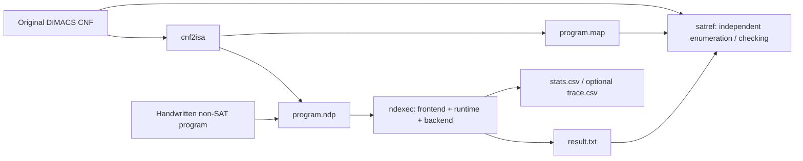
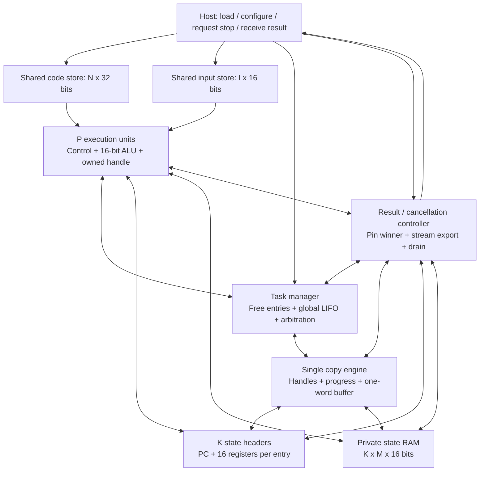

# BNdetC v0.1 Design Specification

**Project:** Build a Non-deterministic Computer  
**Version:** v0.1 architectural baseline  
**Date:** 2026-11-10

**Human decision — Status.** The initial sixteen-item design checklist is complete. This document consolidates the adopted abstract ISA, bounded execution structure, software toolchain, termination protocol and acceptance requirements. It is self-contained and can be used without access to private project notes.

Requirements identified as **Human decision** are the adopted baseline. **AI suggestion** identifies an initial physical mapping or implementation example rather than an additional approved architectural requirement. **Literature evidence** identifies background sources, not project measurements. **Experimental evidence** is reported separately in Section 12.

The baseline runs naturally until acceptance, complete exhaustion, an execution error, resource failure or a controlled external stop. It does not require an instruction quota or another mandatory runtime budget. Optional experimental cutoffs are external policies using the same stop interface.

## Contents

1. [Purpose and scope](#1-purpose-and-scope)
2. [Machine parameters and initial state](#2-machine-parameters-and-initial-state)
3. [Instruction semantics](#3-instruction-semantics)
4. [Encoding and assembly interface](#4-encoding-and-assembly-interface)
5. [Programs, files and toolchain](#5-programs-files-and-toolchain)
6. [Branch state and ownership](#6-branch-state-and-ownership)
7. [GUESS and scheduling](#7-guess-and-scheduling)
8. [Results, cancellation and completion](#8-results-cancellation-and-completion)
9. [Capacity and resource accounting](#9-capacity-and-resource-accounting)
10. [Execution backends and hardware mapping](#10-execution-backends-and-hardware-mapping)
11. [Performance observation](#11-performance-observation)
12. [Acceptance and evidence](#12-acceptance-and-evidence)
13. [Implementation details and versioning](#13-implementation-details-and-versioning)
14. [Design checklist coverage](#14-design-checklist-coverage)
15. [Background references](#15-background-references)

## 1. Purpose and scope

**Human decision.** BNdetC is a programmable abstract machine for executing nondeterministic computation trees with finite concurrent execution resources. Its research focus is the performance and resource cost of branch execution, state management, scheduling, copying and cancellation.

The adopted framing is:

> An abstract instruction interface, a bounded execution structure, near-term C validation, and a long-term FPGA orientation. Concrete hardware and eventual research contributions are to be determined from implementation evidence and resource tradeoffs.

`GUESS` expresses alternative executions. The runtime explores those alternatives using finite resources; it does not invoke an oracle, sample one random outcome or create unlimited physical threads. Ordinary deterministic instructions make the interface usable beyond SAT.

The initial implementation consists of three independent C programs. A single host thread drives the functional executor and the subsequent timing simulator. The model may contain several independently progressing execution units even though the simulator itself uses one host thread.

FPGA implementation is a long-term direction, not a guaranteed immediate or final deliverable. The abstract ISA is an implementation contract for this baseline, not a finalized physical processor interface. Performance analysis must follow functional validation promptly.

The baseline establishes a reproducible machine to study. It does not establish novelty, optimality or exponential acceleration. For the same work and equal-speed execution units, fixed P limits pure parallel scaling; first-solution search can also change the amount of explored work and must be analyzed separately.

## 2. Machine parameters and initial state

**Human decision.** The following parameters remain fixed during one run.

| Parameter | Meaning | Baseline rule |
|---|---|---|
| Data word | Register and data-memory value | 16 bits |
| Instruction word | One encoded native instruction | 32 bits |
| PC | Native instruction index | 16 effective address bits; no wraparound |
| N | Number of native instructions after expansion | Nonempty program; at most 65,536 instructions and within configured code capacity |
| I | Shared input length | Nonnegative number of 16-bit words |
| M | Private memory per branch | Nonnegative number of 16-bit words, declared by the program image |
| P | Execution slots | Configurable; default 4 |
| K | Resident branch-state entries | Configurable; default 64; `1 <= P <= K` |
| Export descriptor | Successful output locations | Program-declared ordinary registers and private-memory ranges |
| Trace capacity | Optional event recording | Disabled by default; bounded when enabled |

Defaults P=4 and K=64 are neither architecture maxima nor the only supported settings. P=1 provides a useful baseline; other legal values, such as 2 and 8, support comparisons. M is read at load time and is not a universal hardcoded constant. The state pool is preallocated using M and K; it cannot grow during search.

### 2.1 Registers and numeric interpretation

| Name | Encoding | Role |
|---|---|---|
| R0-R11 | 0-11 | Twelve ordinary program registers |
| S0 | 12 | Reserved temporary used by SUB expansion |
| S1-S3 | 13-15 | Reserved; no assigned software role |

All sixteen registers are 16-bit branch-private state. R0 is writable and is not a constant-zero register. PC, IR and backend control registers are separate from this namespace. Ordinary source programs use R0-R11; internally generated SUB expansion may access S0. This convention does not introduce a privilege mode.

Ordinary arithmetic and numeric immediates use signed two's-complement interpretation, from -32,768 to 32,767. ADD and ADDI retain the low 16 result bits, with no overflow trap. LT compares signed values; EQ compares complete 16-bit values. Comparison results are full-word 0 or 1.

```text
word(x)   = x modulo 65536
signed(u) = u, if u < 32768; otherwise u - 65536
```

C code must implement these target rules explicitly instead of depending on host signed overflow or implementation-dependent narrowing. Signed comparison cannot be replaced by testing the sign of a wrapped subtraction.

### 2.2 Code, data and addresses

Code and data are separate. Code contains immutable 32-bit instructions. Data addresses identify 16-bit words, not bytes.

| Logical data address a | Meaning | Access |
|---|---|---|
| `0 <= a < I` | Shared input | Read only |
| `I <= a < I+M` | Current branch's private memory | Read/write |
| Otherwise | Unallocated | ERROR |

`I + M <= 65536`. Address registers are interpreted as unsigned 16-bit bit patterns, even though arithmetic and LT use signed values. Thus `0xFFFF` denotes -1 as a number and 65,535 as an address; allocation still determines whether it is accessible.

LOAD and STORE use register-indirect addressing without offsets or a separate space operand. The same private logical address in two branches refers to isolated storage. Physical state-pool addressing combines a handle with a private offset; it does not enlarge the guest logical address.

PC indexes native instructions, with entry point 0. A sequential successor is PC+1, not PC+2 or PC+4. Jump targets are unsigned absolute instruction indices. Labels resolve after pseudo-instruction expansion. Reaching outside the loaded code range is ERROR, with no PC wraparound or implicit successful halt. STOP and a failing ASSERT terminate their path without requiring a sequential successor.

Length calculations, PC increment checks and allocation products require sufficiently wide host intermediates: the length 65,536 must not become zero through a 16-bit conversion. Data-address arithmetic still follows ordinary modulo-65,536 ADD/ADDI semantics; memory access performs no additional modulo operation against I or M.

### 2.3 Initial state

Execution begins with exactly one branch at PC=0. All sixteen registers and all M private words are zero. The shared input is loaded completely; missing input or a length mismatch is ERROR. Reading an allocated but not previously written register or private word returns zero.

## 3. Instruction semantics

**Human decision.** There are fifteen native instructions. Operands are read from the pre-instruction state; only architecturally specified destinations change. Ordinary continuing instructions advance PC by one unless control flow says otherwise.

| Instruction | Effect |
|---|---|
| `MOVI rd, imm` | Write the 16-bit immediate bit pattern to rd. |
| `ADD rd, ra, rb` | `rd = word(ra + rb)`. |
| `ADDI rd, ra, imm` | `rd = word(ra + imm)`. |
| `AND rd, ra, rb` | Full-word bitwise AND. |
| `OR rd, ra, rb` | Full-word bitwise OR. |
| `NOT rd, ra` | Complement all sixteen bits. |
| `EQ rd, ra, rb` | Write 1 if equal, otherwise 0. |
| `LT rd, ra, rb` | Write 1 if `signed(ra) < signed(rb)`, otherwise 0. |
| `LOAD rd, [ra]` | Read one allocated input/private word into rd. |
| `STORE [ra], rb` | Write rb to one allocated private word. Writing input or code is ERROR. |
| `JMP label` / `JMP ra` | Set PC to an immediate absolute target or the unsigned target held in ra. No link register is written. |
| `JZ ra, label` | Jump to the immediate absolute target if ra is zero; otherwise advance PC. |
| `GUESS rd` | Form two isolated successors with rd=0 and rd=1 and the same next PC. See Section 7. |
| `ASSERT ra` | Continue if ra is nonzero; otherwise terminate this branch as a normal failure. |
| `STOP` | Propose successful acceptance with the program-declared output. See Section 8. |

Conditions are explicit values in ordinary registers. There are no implicit N/Z/P flags. JZ and ASSERT test zero/nonzero; they do not require an input to be exactly 0 or 1. For example, `NOT 1` produces `0xFFFE`, which is nonzero. Logical Boolean negation can be expressed by comparison with a register containing zero.

GUESS may overwrite the same register repeatedly. GUESS and ASSERT may interleave, and deterministic instructions and loops may occur between them. ASSERT tests its operand at that point; it does not install a symbolic constraint that is automatically reevaluated later.

No shift instructions, additional convenience arithmetic, CALL or RET are included. Functions can use an ordinary register containing a return address, `MOVI rd, return_label`, and register-mode JMP. Programs manage their own branch-private save areas or stacks. No global calling convention, automatic stack or special role for S1-S3 is imposed.

## 4. Encoding and assembly interface

**Human decision.** Instructions use this fixed layout:

```text
31          28 27       24 23       20 19       16 15                 0
+-------------+-----------+-----------+-----------+--------------------+
| opcode: 4   | rd: 4     | ra: 4     | rb: 4     | payload: 16        |
+-------------+-----------+-----------+-----------+--------------------+
```

The rb field becomes a mode field for JMP. Fixed zero fields below are reserved bits, not implicit references to R0. Only valid source operands are read.

### 4.1 Opcode allocation

| High two opcode bits / low two opcode bits | 00 | 01 | 10 | 11 |
|---|---|---|---|---|
| 00 | ADD (0) | AND (1) | EQ (2) | MOVI (3) |
| 01 | ADDI (4) | OR (5) | LT (6) | LOAD (7) |
| 10 | JMP (8) | NOT (9) | JZ (A) | STORE (B) |
| 11 | STOP (C) | Reserved (D) | ASSERT (E) | GUESS (F) |

The high and low opcode bits refer to instruction bits [31:30] and [29:28]. Suffix families can help organize decoding but are not unconditional ALU, memory or register-write enables. Legality and execution state still control resource use.

### 4.2 Complete format table

| Instruction | Opcode, hex | rd | ra | rb / mode | Payload |
|---|---|---|---|---|---|
| ADD | 0 | rd | ra | rb | 0 |
| AND | 1 | rd | ra | rb | 0 |
| EQ | 2 | rd | ra | rb | 0 |
| MOVI | 3 | rd | 0 | 0 | imm16 |
| ADDI | 4 | rd | ra | 0 | imm16 |
| OR | 5 | rd | ra | rb | 0 |
| LT | 6 | rd | ra | rb | 0 |
| LOAD | 7 | rd | ra | 0 | 0 |
| JMP absolute | 8 | 0 | 0 | 0000 | target16 |
| JMP register | 8 | 0 | ra | 0001 | 0 |
| NOT | 9 | rd | ra | 0 | 0 |
| JZ | A | 0 | ra | 0 | target16 |
| STORE | B | 0 | ra | rb | 0 |
| STOP | C | 0 | 0 | 0 | 0 |
| Reserved | D | Invalid | Invalid | Invalid | Invalid |
| ASSERT | E | 0 | ra | 0 | 0 |
| GUESS | F | rd | 0 | 0 | 0 |

MOVI/ADDI have a full signed numeric imm16; absolute JMP/JZ have a full unsigned target16. Other payloads must be zero. All unused register fields must be zero. Opcode D, JMP modes 2-15, nonzero unused fields and every other unsupported encoding produce ERROR. The executor does not guess future extension semantics.

JMP mode 0001 is not a read of R1. Absolute `JMP 0` encodes as `0x80000000`; register `JMP R0` encodes as `0x80010000`. JZ has no register-target mode. There are sixteen legal formats because JMP has two formats, while the native instruction count remains fifteen.

### 4.3 Pseudo-instructions and labels

Exactly four pseudo-instructions are provided:

| Pseudo-instruction | Expansion | Native instructions |
|---|---|---|
| `MOV rd, ra` | `ADDI rd, ra, 0` | 1 |
| `INC rd` | `ADDI rd, rd, 1` | 1 |
| `DEC rd` | `ADDI rd, rd, -1` | 1 |
| `SUB rd, ra, rb` | Sequence below | 3 |

```text
NOT  S0, rb
ADDI S0, S0, 1
ADD  rd, ra, S0
```

SUB clobbers S0. Its ordinary operands use R0-R11, so destination/source aliasing is safe and S0 is not an exposed SUB operand. S0 remains branch-private and must survive switching between the expanded native instructions. There are no LI, J or BEQZ aliases.

The frontend accepts labels, comments, signed decimal numeric values and hexadecimal raw 16-bit values from `0x0000` to `0xFFFF`. Absolute code targets use their unsigned address interpretation. `MOVI rd, label` loads the expanded instruction address as a 16-bit bit pattern, including addresses above 32,767; it is not a new pseudo-instruction.

The initial loader accepts text only. A 32-bit hexadecimal instruction dump may be provided for inspection; binary-file loading and file byte order are not part of v0.1.

## 5. Programs, files and toolchain

**Human decision.** Three independent C programs communicate through files. The executor contains its own small assembly frontend; there is no fourth standalone assembler.



| Program / artifact | Contract |
|---|---|
| `cnf2isa` | Translate original CNF into an ISA program image and SAT variable/output mapping. It is a simple frontend tool. |
| `ndexec` | Load a generic program image, input and run/backend configuration; execute encoded native instructions; produce generic results and observations. Backends may be replaced without changing the ISA. |
| `satref` | Independently parse original CNF, enumerate small instances and/or check an exported assignment using the mapping. It must not reuse the executor's search or translator's solving logic. |
| `program.ndp` | UTF-8 image containing format/ISA versions, input length/data, private length M, output descriptor and assembly source. The loaded image determines N after expansion. |
| `program.map` | SAT-variable-to-private-logical-address mapping, used by tools rather than the generic executor. |
| `result.txt` | Generic terminal status, reason and, for ACCEPT, the declared exported data. |
| `stats.csv` | Input/version identity, run configuration, status and statistics. |
| `trace.csv` | Optional bounded event trace, disabled by default. |

The image must provide all declared input words. Its output descriptor identifies ordinary registers and valid private-memory ranges. Every STOP in one program uses that same descriptor; STOP's instruction bits do not encode output locations.

The field-level image/file contract is fixed. Exact section delimiters, token spellings, CSV columns, CLI flags and C interfaces are implementation details to be documented consistently when implemented; this specification does not invent a second unapproved file grammar.

### 5.1 Fixed CNF translation

Each Boolean variable x1 through xn occupies one private 16-bit word in index order. Registers hold scratch values. The translator guesses variables in that order, stores them, then evaluates clauses in original order and executes ASSERT for each clause. A positive literal uses the stored 0/1; a negative literal uses EQ against zero. OR reduces the clause. STOP follows successful checking.

The translator performs no variable/clause reordering, propagation, duplicate elimination or SAT-specific search optimization. It exports the full assignment and its mapping. This all-GUESS-before-check ordering is a translator baseline, not an ISA restriction.

DIMACS parsing uses zero as the clause delimiter. Clauses may cross lines and several clauses may share a line. An empty clause produces a false assertion; zero clauses require no clause assertions. Zero-variable boundary cases must also be handled correctly.

Expanded code length, jump targets and data requirements must fit their encodable and configured ranges. Translation overflow is an error, not truncation or an UNSAT result. The old high-level count of guesses plus clauses is not the native instruction count.

### 5.2 Generic results

| Status | Meaning | SAT-layer interpretation |
|---|---|---|
| ACCEPT | A branch successfully reaches STOP; complete exported data is available. | SAT, subject to independent witness checking |
| EXHAUSTED | All represented work was completely explored without acceptance. | UNSAT |
| UNKNOWN | Search is incomplete because of resource failure or a controlled external stop; include the reason. | No SAT/UNSAT conclusion |
| ERROR | Invalid program/input/configuration or an execution/runtime fault; include diagnostics. | Error |

The generic executor does not parse CNF or verify SAT itself. Other workloads need their own output interpretation and correctness checks.

## 6. Branch state and ownership

**Human decision.** Code, input and program metadata are immutable and shared. A stable branch snapshot is:

```text
BranchState = { PC, registers[16], private_memory[M] }
```

The snapshot includes S0-S3. Program-managed return addresses and stacks, when present, are contained in registers/private memory. No implicit condition flags or full choice history are needed for restoration. The runtime's pending-work LIFO is not a program call stack and is not copied into a snapshot.

Snapshots and transfers use committed native-instruction boundaries, with PC naming the next instruction to execute. IR and decode/ALU temporaries are normally reconstructible and are not part of this stable payload. In-flight operations, copy progress, reservations and control state are separate bounded runtime storage.

A pool contains K preallocated state entries. Each execution slot directly operates its owned entry through a handle; it does not secretly retain an additional full branch copy. READY tasks and transfers use handles. Mutable private memory must actually be copied at a fork; copying a pointer to shared writable storage is incorrect.

Required invariants are:

1. Each live executable state has exactly one owner: a slot or one READY position.
2. A copy destination is reserved, counted in K and not executable until completion.
3. A copying source remains stable until its copy completes or is safely cancelled.
4. A result-retained state stays immutable until output extraction finishes.
5. No entry is reused while a slot, copy engine, memory transaction, exporter or pending control action can still access it.
6. Every reservation/request is committed or safely released; no unbounded work or history is hidden outside the pool.

State handles identify current pool entries and may be reused after safe reclamation. They are not globally unique search-tree node numbers.

## 7. GUESS and scheduling

### 7.1 Fork protocol

**Human decision.** GUESS preserves the original entry for the 0 successor and allocates one additional entry for the 1 successor.

1. At a stable instruction boundary, request one FREE pool entry before committing GUESS.
2. Reserve the destination and retain the source's slot ownership. If the copy engine is busy, wait with bounded request metadata and the reservation counted in K.
3. Copy the complete stable payload while keeping the source unchanged. The destination must not be dispatched or placed on the READY LIFO yet.
4. On successful completion, set original rd=0 and destination rd=1; both PCs point to the next native instruction. Publish the two isolated successors as one logical fork commit.
5. The original slot continues its 0 successor. Push the new 1-successor handle onto the global LIFO. It can remain there until a slot becomes free.

A completed copy moves a logical payload of `34 + 2M` bytes. Reads, writes, successor patching and control traffic are accounted separately; neither copying nor restoration is assumed to be free or one cycle.

Each slot has at most one outstanding native instruction/request. A waiting copy request can reside in that slot's bounded descriptor; the initial copy engine processes one copy at a time. An unavailable engine/port causes WAIT, not UNKNOWN. Cancellation of a partial copy follows Section 8.

### 7.2 Task selection

**Human decision.** Use one global LIFO of READY handles. There are no per-slot alternative stacks, work stealing or global per-instruction FIFO in the initial baseline.

Once assigned, a branch stays with its slot while progressing or waiting. WAIT does not make the slot free or cause implicit preemption. A failing ASSERT ends that branch and safely returns its entry; STOP submits a success request. An empty slot takes the newest READY handle. Assignment transfers ownership, not another full payload copy.

The functional backend visits slots in cyclic slot-number order, advances one native instruction for a runnable slot, and skips waiting/empty slots. A newly assigned branch begins on that slot's next visit. Native instructions inside SUB are separate steps.

The timing backend uses the same branch ownership and LIFO policy, but independent units progress at their own ready times. Shared-resource requests use explicit, reproducible arbitration; the initial mapping uses round-robin arbitration. Functional traversal order is not a serialized target-machine timing rule.

Natural execution has no universal termination guarantee. An infinite path can retain a slot and postpone READY alternatives; LIFO is not fair over arbitrary infinite computation trees. Finite resident resources do not imply finite execution time or that every finite search fits K.

## 8. Results, cancellation and completion

**Human decision.** A common result/cancellation controller handles successful STOP, errors, resource stops and external stop requests. The following phase names describe the protocol rather than a frozen C enum or RTL encoding:

```mermaid
stateDiagram-v2
    [*] --> RUNNING
    RUNNING --> DRAINING: latch terminal outcome and close work admission
    DRAINING --> DONE: output ready if needed; no outstanding accesses; reclaimed
    DONE --> [*]
```



### 8.1 STOP arbitration and output publication

A STOP request is eligible only after prior instructions and memory accesses have completed. Freeze each candidate while it awaits arbitration. Compare success-ready model times first. Only for successes at the same arbitration time, choose the smallest state-pool entry number. Collect the same-time events before deciding; a later success cannot replace an earlier winner because its handle is smaller.

In the functional backend, functional events determine arrival order. A slot traversal round has no physical simultaneity or cycle meaning.

When success wins, latch `winner_handle`, retain the immutable state within K, and close admission of new dispatches, native instructions and GUESS successor publication. Extract the program-declared output by streaming from that state with bounded buffering. Set `result_valid` only when all exported data is ready. Keep the entry until extraction is finished; do not add an unaccounted full-state result copy.

Cancellation and export may overlap. The externally visible run completes only when its output, where required, is ready and safe reclamation has finished. Output transfer consumes modeled ports, bandwidth and time; host file-writing time is separately a software cost.

### 8.2 Same-time outcome priority

Before an outcome is latched, use the following priority within one arbitration instant:

| Priority | Eligible condition | Outcome |
|---|---|---|
| 1 | Reportable execution error | ERROR |
| 2 | No error and at least one eligible STOP | ACCEPT; smallest handle breaks a same-time success tie |
| 3 | No above event and complete exhaustion is established | EXHAUSTED |
| 4 | Otherwise, a resource stop or external cancellation prevents completion | UNKNOWN |

This is an executor policy. It does not require exploring cancelled branches to discover potential errors. An ordinary late completion/stop notification after outcome selection cannot replace the latched outcome. Runtime corruption or an output/reclamation failure must still be reported rather than silently treated as normal cancellation.

### 8.3 Unified external cancellation

The adopted run policy is **natural execution plus a unified external cancellation interface**. There is no mandatory instruction-count, GUESS-count, branch-depth, wall-time or modeled-cycle budget, and no adopted numeric cutoff such as ten million instructions.

The interface accepts a controlled stop request and its reason, then routes it through the same admission fence, draining and reclamation protocol. Repeated requests must not create an unbounded request queue or restart cancellation. If no conclusive result has already won, an incomplete externally stopped search returns UNKNOWN with a reason; it does not return EXHAUSTED.

The interface is conceptual; the C API, signal/flag plumbing or control channel is an implementation choice. A test harness can use a host timeout, a timing experiment can use a modeled deadline, and a future host/FPGA interface can request a stop. These triggers are optional run/experiment policies, not mandatory guest instructions or part of the baseline's ordinary instruction-issue path. Record any enabled trigger and its observation granularity.

Instruction counts remain useful observations even when no quota is enabled. No per-instruction global hardware handshake is implied by host-side statistics or protection. A future optional deadline policy must document boundary handling; this specification does not silently reinstate an earlier quota proposal.

### 8.4 Cooperative draining and reclamation

| Object | Required behavior after the admission fence |
|---|---|
| READY LIFO entries | Become ineligible for dispatch; the manager subsequently reclaims their storage. |
| Execution slots | Start no next instruction. Finish handshakes for already-issued accesses before releasing referenced state. |
| Queued copy requests | Withdraw the request and reservation only after the copy engine can no longer acquire them. |
| Active copy | Stop at the next word-transfer safe point. Let issued reads/writes finish; do not copy the remaining payload or publish successors. |
| Partially copied destination | Remain non-executable and retained until no operation can access it, then reclaim it. |
| Winner | Remain pinned until output extraction completes. |
| Controller and memory | Acknowledge draining; clear outstanding ownership/reservations only when responses and control transfers have settled. |

Clearing a queue index or setting a done flag does not itself establish safe reclamation. Logical cancellation of READY work and physical cleanup can take different times. Do not start another run or reuse entries while old operations can still reference them.

The initial one-word copy buffer permits a safe stopping point without completing the rest of a snapshot. Count the traffic actually performed, including partial copies. No cancelled copy may create a new READY child after the admission fence.

### 8.5 Complete exhaustion

EXHAUSTED requires a consistent normal-search state in which all of the following hold:

- No branch still needs execution, including resource-waiting branches, and the READY LIFO is empty.
- No copy destination is reserved and no native instruction, memory access or copy is in flight.
- No task transfer, management operation or terminal notification remains pending.
- No successful result exists and no work has been abandoned because of resource failure or external cancellation.

Check after the relevant same-time state transitions, not in an ownership-transfer gap. Centralized counters/valid bits may implement the check, but their updates must preserve ownership accounting. Merely observing idle execution slots is insufficient.

Once draining has deliberately discarded work, the empty system returns the previously selected outcome. It cannot acquire an EXHAUSTED result by cancellation. Likewise, an ordinary failed ASSERT, incomplete search and malformed program must remain distinct.

## 9. Capacity and resource accounting

**Human decision.** Preallocate all search-state and control capacities. K includes slot-owned states, READY alternatives, reserved copy destinations and retained results. A copying source is already counted as its owned state; do not count it twice. The LIFO allocates K handle positions, not K additional full snapshots.

When the manager serves a GUESS reservation and no FREE entry exists, request `UNKNOWN(STATE_CAPACITY)` before committing GUESS. Do not drop the 1 successor, overwrite another entry, silently switch to replay, grow the heap or recurse through an unbounded host stack. Same-time STOP/error priority still applies.

This fail-fast behavior is a conservative baseline choice. It is not proof that another scheduler or state representation could not solve the input with the same storage. Waiting for a busy port or copy engine is ordinary WAIT and must not be mislabeled as capacity exhaustion.

The logical stable payload size is:

```text
B_state = 2 + 16 * 2 + M * 2 = 34 + 2M bytes
B_total = 4N + 2I + K * (34 + 2M) + B_runtime
```

`B_runtime` includes entry ownership/validity metadata, free-entry management, LIFO handles, slot control, pending requests/reservations, copy progress/buffering, bounded timing events, result/export control and bounded optional trace storage. In-flight source/destination handles and temporary operands are not free storage. Any later register cache, code replication or shadow state must be added to the accounting.

The event container must be bounded by the configured units/ports and their outstanding operations, not by total executed instructions. No search-sized history or indefinitely growing trace may be concealed in host allocations. Logging limits and overflow/truncation behavior must be stated without silently dropping search alternatives.

Report actual C allocation/alignment separately. For FPGA, RAM packing, selectors, routing, arbiters, ALUs and control logic require separate accounting; the byte formula is not a hardware-area prediction. Invalid declarations/configurations are ERROR; inability to run a valid image within available resources is UNKNOWN with a resource reason. Allocation arithmetic and failures must never become a false no-solution result.

## 10. Execution backends and hardware mapping

### 10.1 Adopted backend separation

**Human decision.** Assembly/loading, ISA semantics, state ownership and backend timing are separate. Preserve operation start, wait and completion boundaries. The first backend validates functionality using one host thread; the immediately following backend adds discrete-event timing, also using one host thread.

The timing model has independent unit progress, memory/copy bandwidth, control delays and resource contention. Process same-time requests through explicit sampling, arbitration and commit rules. A C loop that evaluates four units sequentially can represent overlapping target operations; its call order and host runtime do not determine target elapsed time.

One native instruction is not necessarily one cycle. For example, while one slot waits for a frozen-source copy, other slots may compute if their required resources are available. Requests contending for the same port must wait.

### 10.2 Initial hardware sketch

**AI suggestion — Working mapping.** The following mapping makes hardware assumptions visible to the timing model. It is an initial profile, not a finalized FPGA layout, synthesized implementation or calibrated cycle model. Interface arrows do not imply zero-delay or unlimited-bandwidth access.



| Resource | Initial modeling assumption |
|---|---|
| Execution units | P simple controllers/16-bit ALUs; one outstanding native instruction per slot; no pipeline/speculative/out-of-order execution. |
| Code store | Two synchronous 32-bit read ports shared through arbitration; no implicit P-fold code replication. |
| Input store | One shared synchronous 16-bit read port. |
| State PC/register headers | Per-entry register arrays; each active entry supplies two register reads and one register write, with PC updated separately. The copying source/destination are exclusively controlled by the copy engine. Selection and write-routing logic have an explicit hardware cost. |
| Private RAM | Two 16-bit ports: A shared by slot-private LOAD/STORE requests; B used by the copy engine for reads/writes. Accesses using one port serialize. |
| Copy engine | One copy at a time and one-word buffering; reads and writes consume access bandwidth. |
| Task manager | Serial control transactions, at most one pending request per slot, with reproducible round-robin arbitration and explicit service delay. |
| Export/controller | Reuse accounted state-access paths with arbitration and bounded buffering; do not invent an extra free output port. Model control, drain and export latency. |

Different banks or port counts are possible later, but the model and cost accounting must change together. Register-array access does not imply cheap multiport RAM. Shared private-memory ports may constrain scaling even when more execution slots exist. No arbitrary P/K/M combination is promised to fit one FPGA.

Before timing experiments, fix and report instruction, fetch, memory, copy, arbitration and controller delays/occupancies. A profile must not permit unbounded native-instruction execution at one timestamp; any zero-time internal bookkeeping must reach a finite closure. Numerical latency values, target clock frequency and physical RAM layout have not been calibrated. These engineering parameters do not reopen the adopted ISA or runtime policies.

## 11. Performance observation

**Human decision.** Performance is a research objective, with functional correctness and complete resource accounting as prerequisites. Required observations include:

| Observation | Required interpretation |
|---|---|
| Native instruction counts by opcode | Count expanded instructions; distinguish issued/completed work where an operation may be cancelled. |
| Forks and failed branches | Record GUESS, ASSERT failures and work actually performed; pruned subtrees are not individually visited leaves. |
| State operations | Record copy/assignment/restoration events and actual payload, read/write and partial-copy traffic separately. Handle transfer is not a full-state copy. |
| Resource peaks | Slot ownership, READY entries, reserved destinations, result retention and total state/control usage. |
| Terminal lifecycle | First success-ready event, winner selection, output readiness, computational quiescence and full reclamation. |
| Timing-only observations | Search/complete-no-solution time, waiting by resource, utilization, copy/control costs and cancellation tail. |
| Run identity | Image/input identity, ISA/format/executor versions, P/K/M, backend and timing parameters, instrumentation settings, external-stop policy/reason and final status. |

Functional event indices are not cycles. Host wall time measures simulator cost. Timing-backend units are modeled time; FPGA measurements would be a fourth, separately identified quantity. No conversion from modeled cycles to physical time is justified without a target clock and calibration.

Export and cancellation may overlap, so output-ready and computation-stopped times must be recorded independently. Full reclamation follows the disappearance of outstanding references and completion of required export. A quickly returned UNKNOWN is not a faster solution.

Compare P=1 and multi-slot configurations under documented resource and workload conditions. Account for differences in search order and explored work before attributing a first-solution improvement to faster execution. Increasing P, changing K or changing memory ports changes different resources; comparisons must say which are held fixed. Instrumentation overhead and bounded trace settings are also part of the run record.

## 12. Acceptance and evidence

**Human decision.** The first acceptance gate is functional execution plus independent validation. The immediately following gate checks timing/resource consistency. A functional pass alone does not complete performance research.

| Area | Minimum coverage |
|---|---|
| Arithmetic and predicates | Signed boundaries, modulo wraparound, bitwise NOT versus Boolean negation, full-word 0/1 comparisons, destination/source aliasing. |
| Encoding/frontend | All fifteen operations and both JMP modes; strict zero fields; reserved D/unsupported modes; macro expansion, S0 handling, labels, numeric/address interpretations. |
| Code/data behavior | LOAD/STORE isolation, input protection, missing input, zero initialization, invalid PC/address, no PC wrap or implicit fall-through success. |
| Branching | Repeated GUESS, interleaved GUESS/ASSERT, full register/private-state isolation, S0 preservation and no duplicated/lost alternatives. |
| Bounded resources | More than two slots, full pool before GUESS commit, reservations included in K, bounded requests/events/trace, WAIT distinguished from UNKNOWN. |
| Success/control | Same-time multiple STOPs choose the smallest handle; earlier success wins over later smaller handles; same-time error/capacity/external-stop priority. |
| Cancellation | READY cancellation, waiting/active copy cancellation, memory responses arriving during drain, no post-fence children, pinned output state, no premature entry reuse. |
| Completion | Natural no-acceptance exhaustion, transient idle slots with work in flight, cancellation followed by empty structures, external stop returning UNKNOWN. |
| SAT | Independent parsing/enumeration/checking on fixed edge cases and fixed-seed random small CNFs; initial random comparison set has at most 12 variables. |
| Generality | A non-SAT program, such as bounded subset sum, plus LOAD/STORE, loops and a register-JMP function-return example. |
| Timing | Independent operations overlap when resources permit; single-port conflicts serialize; copy traffic incurs delay; control and cancellation tails are accounted; statistics are internally consistent. |

Different schedules may return different valid witnesses. Compare validity and completed SAT/UNSAT conclusions when sufficient resources permit completion, not identical witnesses or instruction counts. The independent reference cannot confirm UNSAT unless its enumeration completed. For an ordinary integer subset-sum test, choose inputs/reachable sums that avoid confusing 16-bit modular arithmetic with the intended integer problem.

**Experimental evidence — Current status.** This document records the completed initial design. No new v0.1 C executables, native-ISA test results, timing benchmarks, RTL, synthesis or FPGA measurements are asserted here. Existing historical prototypes do not constitute implementation or validation of this full specification.

## 13. Implementation details and versioning

**Human decision.** The architectural decisions are closed for the initial baseline; this does not mean every engineering constant or serialization token has already been chosen. The following can be settled during implementation within this contract:

- Exact text-image grammar, diagnostics, CLI/API spellings, file-column ordering and source/map presentation.
- C types, checked allocation/layout, deterministic free-entry selection, bounded event storage and trace-limit behavior. Fixed-width statistics must have documented overflow/saturation reporting rather than unbounded counters or an implicit search quota.
- The host transport and observation points for controlled external cancellation.
- Documented same-time microphase ordering that preserves the adopted arbitration, ownership, capacity and completion rules.
- Explicit timing parameters and physical mapping/calibration details for the first timing profile or future FPGA.

These details do not authorize adding native instructions, silently changing result semantics, replacing the LIFO/full-copy baseline or imposing a mandatory instruction quota. Record versions when semantics, encoding, image interpretation, runtime policy or timing configuration change. Keep implementation choices separate from measurements and hypotheses.

Implementation, testing and deployment are separate work from writing this specification. No implementation schedule or hardware delivery promise is introduced by this document.

## 14. Design checklist coverage

**Human decision.** All sixteen original design topics are represented below, including the final natural-run/external-cancel choice.

| Item | Adopted subject | Main sections |
|---|---|---|
| 1 | R0-R11, reserved S0-S3 and SUB temporary | 2.1, 4.3 |
| 2 | Signed values, wrapping addition and comparison | 2.1, 3 |
| 3 | Separate code/data, input/private addressing and LOAD/STORE | 2.2, 3 |
| 4 | PC, jump targets, labels and control flow | 2.2, 4 |
| 5 | Entry state, initialization and errors | 2.3, 5.2 |
| 6 | Four-bit opcodes, fields, JMP modes and strict legality | 4 |
| 7 | Full branch snapshot and bounded pool | 6, 9 |
| 8 | Original-0/new-1 placement and copy protocol | 7.1 |
| 9 | Global LIFO and functional/timed slot progression | 7.2, 10 |
| 10 | Configurable P/K, reservations and full-capacity behavior | 2, 9 |
| 11 | STOP arbitration, publication, cancellation and reclamation | 8.1, 8.2, 8.4 |
| 12 | Complete exhaustion; natural execution with external cancellation | 8.3, 8.5 |
| 13 | Three C programs, text image and result export | 5 |
| 14 | Fixed, simple CNF translation | 5.1 |
| 15 | Functional/timed backends and observations | 10, 11 |
| 16 | Independent correctness and timing/resource acceptance gates | 12 |

## 15. Background references

**Literature evidence — Scope.** These are background precedents for the design, not claims that the entire architecture is new or that the cited systems validate this implementation. This specification does not depend on a private bibliography or unpublished project report.

- Christian Schulte, *Comparing Trailing and Copying for Constraint Programming* (1999), Sections 2-3 and 7-8: state preservation and copying/trailing/recomputation tradeoffs. [Author record](https://www.ps.uni-saarland.de/Publications/details/Schulte%3A99a.html).
- LC-3 and RISC-V provide instruction-encoding precedents, not binary compatibility or a selected control architecture. The fixed register-field discussion was checked in RV32I Sections 1.1.2 and 1.1.4.2. [RISC-V official specification](https://docs.riscv.org/reference/isa/v20260120/unpriv/rv32.html).
- Edsger W. Dijkstra and C. S. Scholten, *Termination Detection for Diffusing Computations*: dynamic-work and in-flight accounting. The consulted author-archive text is draft EWD687a dated 1979, associated with the 1980 publication; this design uses a centralized check rather than that distributed protocol. [Author archive](https://www.cs.utexas.edu/~EWD/transcriptions/EWD06xx/EWD687a.html).
- oneTBB, *Cancellation Without an Exception*, task_group example and final paragraph: queued-task cancellation, cooperative exit of running tasks and waiting. [Official documentation](https://uxlfoundation.github.io/oneTBB/main/tbb_userguide/Cancellation_Without_An_Exception.html).
- Verilator, *Multithreading* and *Simulation Summary Report*: host thread count and simulated versus host elapsed time are separate concepts. [Threading documentation](https://verilator.org/guide/latest/verilating.html#multithreading), [time definitions](https://verilator.org/guide/latest/simulating.html#simulation-summary-report).
- CaDiCaL, `connect_terminator`/`disconnect_terminator` declarations: a caller-controlled termination interface is a precedent for separating triggers from executor control. No SAT backend is selected here. [Official API header](https://github.com/arminbiere/cadical/blob/master/src/cadical.hpp).
